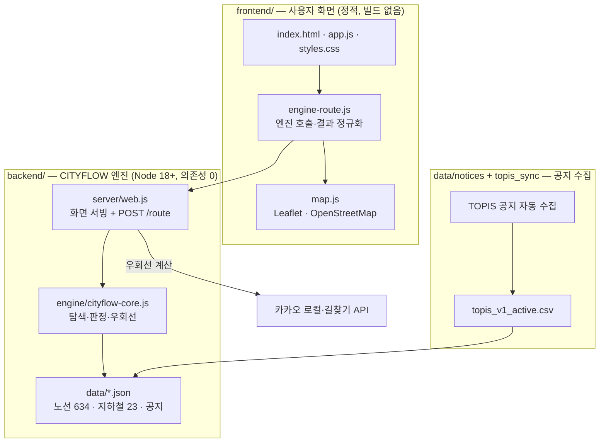
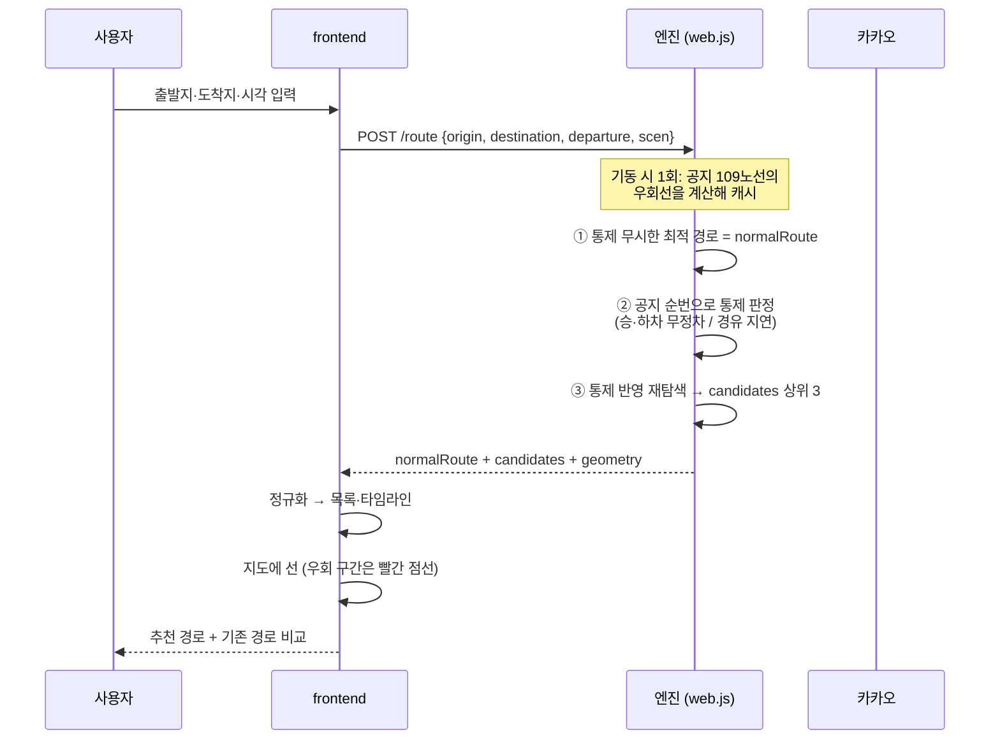

# 구성과 요청 흐름

## 전체 구성



## 요청 한 번의 흐름



기동 시 우회선 계산에 카카오 길찾기를 약 190회 호출해 **수 분**이 걸린다. 그 사이 들어온 요청은 기다렸다가 응답한다. 진행 상황은 `GET /health`.

## 판정이 응답으로 드러나는 자리

| 응답 필드 | 뜻 | 화면 표시 |
|---|---|---|
| `normalRoute` | 통제가 없었다면 최적이었을 경로 | "통제가 없을 때의 최적 경로" 카드 |
| `candidates[]` | 통제를 반영해 다시 찾은 경로(순위순) | 추천 경로 카드 |
| `legs[].detour` | 이 구간은 통제로 길이 달라짐 | 빨간 점선 + "우회" 배지 |
| `legs[].skippedSeqs` | 서지 않고 지나치는 정류소 순번 | "무정차 N곳을 지나갑니다" |
| `notes.detourFailed` | 우회선 계산 실패 → 정상 운행으로 처리 | 안내 문구 |

## 실행

```bash
KAKAO_REST_KEY=<카카오 REST 키> node backend/server/web.js
# → http://localhost:8080
```

| 환경변수 | 기본값 | 용도 |
|---|---|---|
| `KAKAO_REST_KEY` | (없음) | 우회선 계산. 없으면 직선으로 근사 |
| `PORT` | 8080 | 포트 |
| `NO_NET` | - | 설정하면 외부 호출 차단(오프라인 확인용) |
| `WARM_SCEN` | nov | 기동 시 미리 계산할 행사 |
| `DATA_PATH` `EXTRA_PATH` `SUBWAY_PATH` | backend/data/* | 데이터 파일 위치 |

엔진만 띄우려면 `node backend/server/server.js` (전달받은 원본, 화면 서빙 없음).

## 설계에서 지킨 것

**판정과 표시를 분리했다.** "서는지 안 서는지"는 공지의 무정차 정류소 **순번**으로만 판정한다. 우회선 좌표는 표시용이며, 판정 근거로 쓰지 않는다. 우회 도로에 실제로 정차하는지는 어느 공개 자료에도 없다 — 194쪽 공지에 임시정류소 표기가 0건이다.

**추정값을 추정값이라고 적는다.** 소요 시간, 우회 지연, 종료시각 미기재 공지의 기본 종료시각은 모두 추정이다. 자동 생성된 우회 설정 96개 노선이 결과에 들어가면 "확인 필요"로 표시한다.

**공지에 없다는 것이 정상 운행의 보증은 아니다.** 순번을 특정하지 못한 공지는 판정에서 빼고(`topis_v1_hold.csv`) 경고로만 보여 준다.
