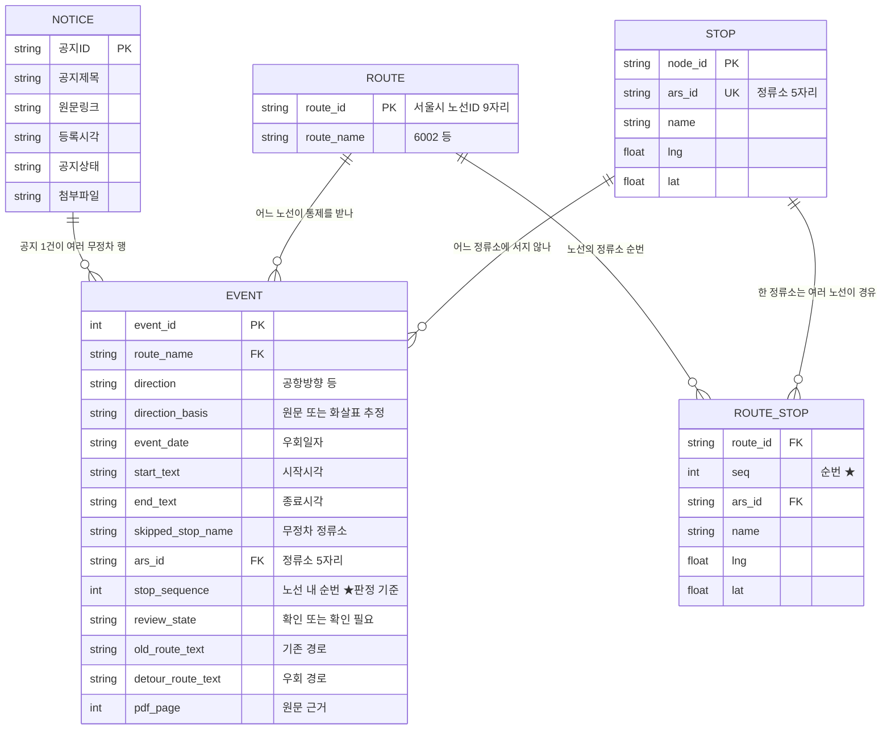
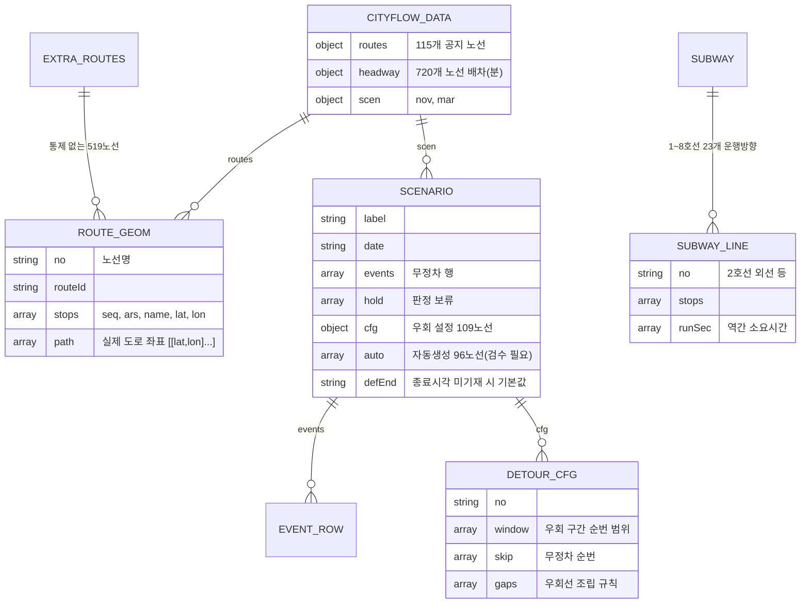
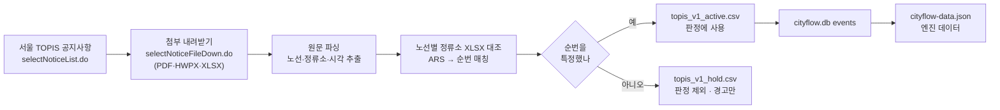

# 데이터 모델 (ERD)

Route B 는 **관계형 DB 한 벌**로 공지를 정규화하고(수집·판정 단계), 조회 때 쓰는 **엔진 데이터 한 벌**로 굳혀 배포한다. 둘을 나눈 이유는 아래 "왜 두 벌인가"에 적었다.

## 1. 수집·판정 단계 (SQLite `cityflow.db`)

규모: `ROUTE_STOP` 41,688행 · `STOP` 11,236행 · `ROUTE` 718행 · `EVENT` 2,905행(5개 행사일).

### 판정의 축은 `stop_sequence`
정류소 **이름**은 공지와 노선 데이터가 서로 다르게 적는다(`한국은행(스프라지르명동)` 같은 표기). 그래서 이름이 아니라 **노선 내 순번**으로 판정한다. 순번을 못 채운 행은 판정에 쓰지 않고 `topis_v1_hold.csv` 로 뺀다.

`ars_id` 는 **방향까지 구분한다**(종로4가.종묘 = `01018` 여의도방향 / `01017` 망우동방향). 그래서 ARS 로 맞추면 방향이 공짜로 따라온다. 공지의 `방향` 칼럼은 1,246/2,729행이 "화살표 추정"이라 신뢰도가 낮고, `direction_basis` 에 그 근거를 남긴다.

## 2. 조회 단계 (엔진 데이터 `backend/data/*.json`)

### 왜 두 벌인가
조회 때마다 SQL 로 순번을 맞추고 우회선을 다시 계산하면 응답이 느리다. 그래서 공지가 갱신될 때 한 번만 정규화·검증해 JSON 으로 굳히고, 엔진은 메모리에 올려 쓴다. 엔진은 **의존성이 없고 DB 도 필요 없다**(Node 18+ 단독 실행).

### 좌표의 출처를 항상 남긴다
한 구간의 선이 무엇으로 그려졌는지 응답에 `detour` 로 표시하고, 화면은 그걸 받아 `path_src` 로 보여 준다.

| 표시 | 뜻 | 신뢰도 |
|---|---|---|
| 노선 공식 형상 | 서울시 `getRoutePath` 의 실제 운행 좌표를 구간만 잘라 쓴 것 | 높음 |
| 우회 좌표(엔진 계산) | 통제로 달라진 구간. 같은 길을 달리는 다른 노선의 공식 경로 차용 > 자기 경로 역방향 재사용 > 카카오 길찾기 순으로 조립 | 중간 |
| 역 사이 직선 | 지하철 구간 | 표시용 |

## 3. 공지 수집 파이프라인

정류소 매칭은 3단계로 내려간다: **ARS 일치 → 이름 정규화 일치 → 좌표 근접(150m)**. 노선명도 정규화한다(`N15(심야)`→`N15`, `급행370`→`370`, `110A고려대`→`110A`). 숫자만으로 맞추면 안 된다 — 마을버스가 2자리 번호를 공유해 `07` 하나에 16개 노선이 걸린다(종로07·강남07·서초07…).

출처: 서울특별시 TOPIS (공공누리 제2유형 · 출처표시, 상업적 이용 금지), 서울교통공사 역간거리·소요시간.
